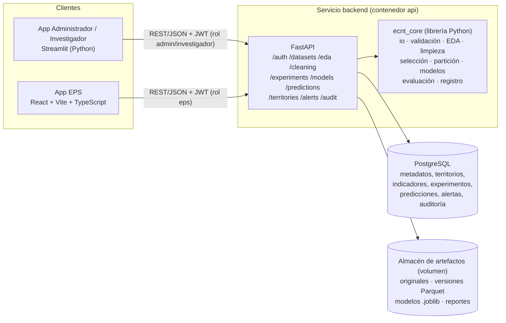
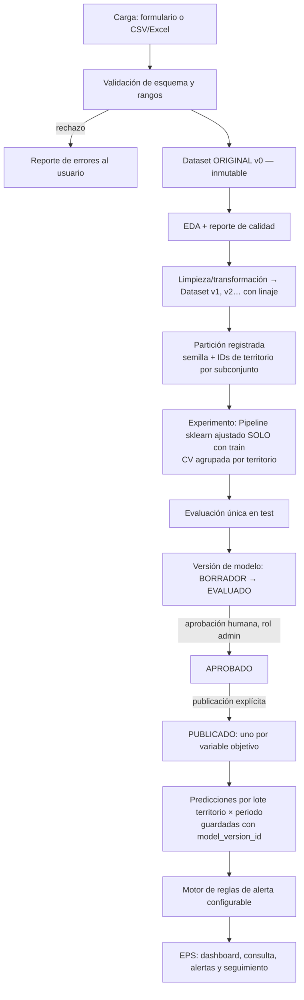

# Arquitectura propuesta — Plataforma ECNT (Grupo 05)

> Estado: **PROPUESTA (Fase 0)** — pendiente de aprobación. Ninguna tecnología se instala hasta la Fase 1.
>
> **Ajuste del 2026-11-17 (entrega el 19‑nov, desarrollador único)**: la app EPS pasa a **Streamlit** (independiente, puerto propio, solo consume la API) y la base de datos por defecto es **SQLite** mediante SQLAlchemy (se puede migrar a PostgreSQL). El resto de la arquitectura se mantiene. Ver AD‑09 a AD‑12 en `DECISIONES.md`.
>
> **Estructura real (Bloque A)**: para un solo desarrollador se usa un único paquete instalable con diseño `src/`: `src/ecnt_core` (núcleo) y `src/ecnt_api` (API), más `apps/admin` y `apps/eps`. La separación lógica de la sección 5 se mantiene; solo cambian las rutas (`packages/ecnt_core` → `src/ecnt_core`, `services/api` → `src/ecnt_api`).

## 1. Principios

1. **Unidad de análisis territorial**: cada observación = territorio × periodo (municipio o municipio × clase de área). Nunca personas.
2. **Un solo núcleo de ciencia de datos** (`ecnt_core`), sin dependencias web. La API lo usa; las interfaces nunca lo importan directamente. Así se evita código duplicado y Diego puede trabajar sin depender del backend.
3. **Dos aplicaciones cliente independientes** (Administrador y EPS) que solo hablan con la API REST.
4. **Inmutabilidad de datos**: el archivo original nunca se modifica; cada limpieza/transformación crea una versión nueva con su linaje.
5. **Reproducibilidad**: todo experimento guarda semilla, versión del dataset, partición (IDs de territorios por subconjunto), hiperparámetros, versión de librerías y métricas.
6. **Sin fuga de información**: imputación, escalado, codificación y selección de variables se ajustan dentro de un `sklearn.Pipeline` usando solo entrenamiento.
7. **Simplicidad proporcional al problema**: ~200 territorios caben en memoria; no se necesitan colas distribuidas, Spark ni MLflow.

## 2. Diagrama de componentes



Vista en texto (por si no se renderiza Mermaid):

```
 [Admin Streamlit] ──┐                     ┌──> [PostgreSQL]
                     ├─ REST + JWT ─> [FastAPI] ─┤
 [EPS React/Vite] ───┘           │         └──> [Artefactos: archivos, Parquet, .joblib]
                                 └─> ecnt_core (EDA, limpieza, ML)
```

## 3. Ciclo de vida de datos y modelos



## 4. Evaluación de tecnologías (qué sí, qué no y por qué)

| Necesidad | Recomendado | Alternativas descartadas / motivo |
|---|---|---|
| Ciencia de datos | Python 3.12, pandas, NumPy, scikit‑learn, SciPy, statsmodels (inferencia de la regresión múltiple: p‑valores, VIF) | — |
| Gráficos | Plotly (Python en Admin, plotly.js o equivalente en EPS) | Matplotlib solo para reportes estáticos. |
| API | **FastAPI** + Pydantic v2 + SQLAlchemy 2 + Alembic | Django REST: más pesado de aprender en el tiempo disponible. |
| Base de datos | **PostgreSQL 16** (Docker). SQLite en memoria para pruebas unitarias | MongoDB: los datos son relacionales/territoriales. |
| Archivos de datos | Original tal cual se cargó + versiones en **Parquet** | Guardar datasets fila a fila en la BD: innecesario para EDA/entrenamiento. |
| Registro de modelos | Tablas propias + archivos `.joblib` con hash SHA‑256 | MLflow: aporta poco con ~5 experimentos/semana y añade un servicio más. |
| Entrenamiento | Ejecución en la API con `BackgroundTasks` + tabla de estado del trabajo | Celery/Redis: innecesario; un entrenamiento con ~200 filas tarda segundos. |
| App Administrador | **Streamlit** multipágina consumiendo la API | Mismo stack Python que Diego; ideal para tablas, EDA y formularios. Limitación: UX menos personalizable (aceptable para uso interno). |
| App EPS | **React + Vite + TypeScript**, React Router, TanStack Query, Plotly/Recharts, **Leaflet** para mapas | Astro: orientado a sitios estáticos/contenido; la EPS es una SPA autenticada, Astro no aporta. Segundo Streamlit: posible si el equipo no maneja React (ver decisión D‑07). |
| Autenticación | JWT (access token corto) + contraseñas con Argon2/bcrypt; roles `admin`, `investigador`, `eps` | OAuth/Keycloak: excesivo para el alcance académico. |
| Mapas | GeoJSON municipal del MGN DANE simplificado (≈200 polígonos del Caribe) | Servidor de teselas/PostGIS: innecesario para este volumen. |
| Despliegue | Docker Compose: `db`, `api`, `admin`, `eps` | Kubernetes: fuera de alcance. |
| Power BI | **Fuera de la plataforma**; opcional: exportación CSV/Parquet para tableros complementarios | Integrarlo duplicaría el dashboard EPS. Ver D‑08. |
| Calidad | pytest, ruff, (frontend) Vitest + ESLint; pre‑commit | — |

## 5. Estructura de carpetas propuesta (monorepo)

```
Proyecto-ECNT/
├── README.md
├── PROJECT_PROGRESS.md            # control de avance (obligatorio)
├── docker-compose.yml             # Fase 1 (esqueleto) / Fase 8 (completo)
├── .env.example                   # nunca .env real en Git
├── .gitignore
├── docs/
│   ├── ARQUITECTURA.md
│   ├── DECISIONES.md              # registro de decisiones (ADR) y pendientes
│   ├── PLAN_DE_TRABAJO.md         # fases, backlog, responsables
│   ├── INVENTARIO_INICIAL.md
│   ├── datos/                     # fichas de fuentes y diccionarios (Fase 2)
│   └── manuales/                  # técnico y de usuario (Fase 8)
├── data/                          # NO versionado (salvo README y datos sintéticos)
│   ├── raw/                       # descargas oficiales tal cual
│   ├── external/                  # geometrías, catálogos DIVIPOLA
│   ├── interim/
│   ├── processed/
│   └── synthetic/                 # datos sintéticos, prefijo SINTETICO_ obligatorio
├── packages/
│   └── ecnt_core/                 # Diego (núcleo), revisado por Harold
│       ├── pyproject.toml
│       ├── src/ecnt_core/
│       │   ├── schemas.py         # esquema canónico de observación territorial
│       │   ├── io/                # lectura CSV/Excel, catálogos DIVIPOLA
│       │   ├── validation/        # tipos, rangos, llaves, duplicados
│       │   ├── eda/               # descriptivos, calidad, frecuencias
│       │   ├── cleaning/          # imputación, outliers, codificación, versiones
│       │   ├── features/          # correlación, VIF, importancia, selección
│       │   ├── splitting/         # aleatoria, agrupada, temporal, geográfica
│       │   ├── models/            # lineal, GB, RF, línea base (media)
│       │   ├── evaluation/        # MAE, RMSE, R², residuos, por grupo
│       │   └── registry/          # serialización, hash, metadatos
│       └── tests/
├── services/
│   └── api/                       # Harold
│       ├── pyproject.toml
│       ├── app/
│       │   ├── main.py
│       │   ├── core/              # config, seguridad, logging
│       │   ├── db/                # sesión, modelos ORM
│       │   ├── schemas/           # Pydantic (contrato de la API)
│       │   ├── routers/           # un archivo por módulo
│       │   └── services/          # lógica de negocio (usa ecnt_core)
│       ├── alembic/
│       └── tests/
├── apps/
│   ├── admin/                     # Luis (UI) + Diego (páginas analíticas)
│   │   ├── Home.py
│   │   ├── pages/
│   │   └── api_client.py          # único punto de contacto con la API
│   └── eps/                       # Luis
│       ├── package.json
│       └── src/{pages,components,api,hooks}
├── notebooks/                     # exploración; nunca código de producción
└── scripts/                       # descarga y ETL reproducibles de fuentes oficiales
```

## 6. Modelo de datos preliminar (se detalla en Fase 5)

| Entidad | Campos clave | Notas |
|---|---|---|
| `usuario`, `rol` | email, hash, rol, activo, `eps_id` | La EPS solo ve sus territorios asignados (si aplica, D‑10). |
| `territorio` | `divipola`, departamento, municipio, `clase_area` (total / cabecera / resto / rural_disperso), geometría | Llave natural = DIVIPOLA de 5 dígitos como texto. |
| `periodo` | año (o rango de años agregados) | |
| `dataset` | nombre, fuente, origen (formulario/archivo), hash, cargado_por, fecha, `es_sintetico` | `es_sintetico` obligatorio y visible en toda la UI. |
| `dataset_version` | `dataset_id`, `padre_id`, operaciones aplicadas (JSON), ruta Parquet, filas/columnas | Linaje completo; v0 = original. |
| `particion` | `dataset_version_id`, estrategia, proporción, semilla, IDs por subconjunto | Garantiza test independiente y reproducible. |
| `experimento` | algoritmo, hiperparámetros, variables, métricas CV y test, librerías, estado | |
| `version_modelo` | `experimento_id`, ruta `.joblib`, hash, estado (borrador/evaluado/aprobado/publicado/retirado), aprobado_por | Un solo `publicado` por variable objetivo. |
| `prediccion` | territorio, periodo, valor, intervalo, `version_modelo_id` | Precalculadas por lote. |
| `regla_alerta` | tipo, parámetros, justificación, activa | Configurable por admin. |
| `alerta` / `alerta_evento` | territorio, periodo, prioridad, estado, responsable / historial de cambios y observaciones | Historial inmutable. |
| `auditoria` | usuario, acción, recurso, fecha, IP | Registro de operaciones. |

## 7. Seguridad y tratamiento de datos

- Solo datos **agregados** territoriales; no se cargan ni almacenan datos personales. La API rechaza columnas que parezcan identificadores personales (documento, nombre, etc.).
- **Supresión de celdas pequeñas**: conteos < umbral (p. ej. 10) no se muestran a la EPS (D‑11).
- Secretos solo en `.env` (fuera de Git). CORS restringido a los dos orígenes de las apps.
- Separación de roles en la API (no solo en la UI): los endpoints de entrenamiento rechazan el rol `eps`.
- Leyenda visible en la EPS: *"Herramienta de apoyo a la planificación en salud pública. No realiza diagnósticos."*

## 8. Contrato entre equipos

La API se diseña **contrato primero** (OpenAPI generado por FastAPI). En la semana inicial de la Fase 5 se publica el contrato con respuestas simuladas para que Luis construya las interfaces en paralelo sin esperar al backend real.
